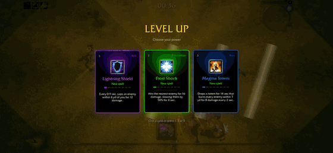
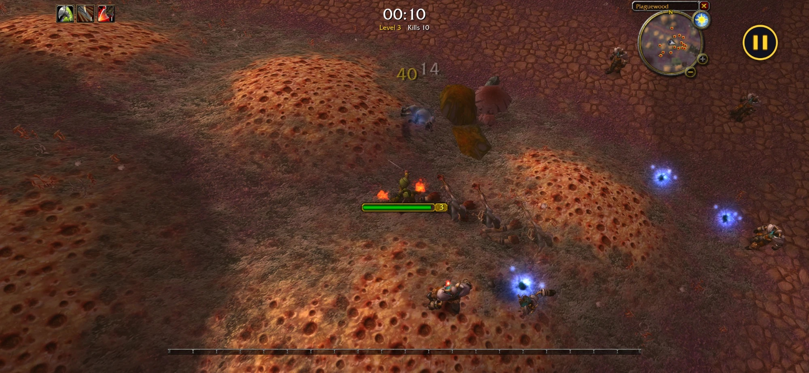
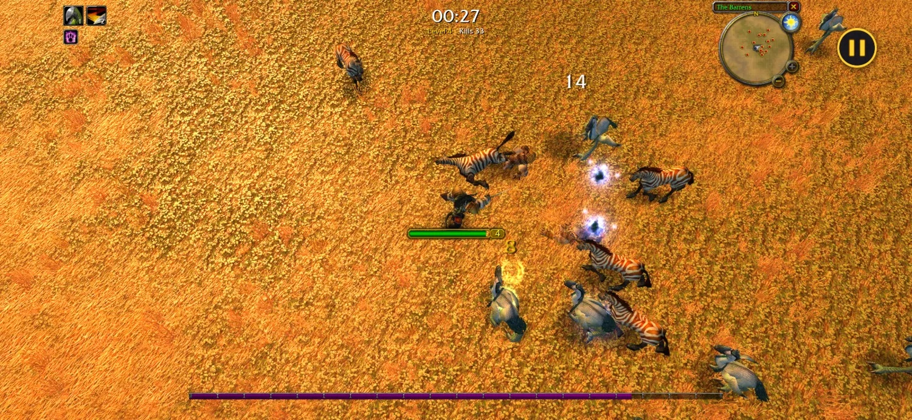
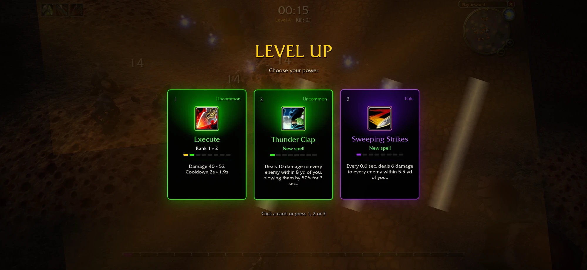

<div align="center">

# Azeroth Survivors for macOS and iOS

**A native Mac and iPhone/iPad port of
[azeroth-survivors-re](https://github.com/OutThisLife/azeroth-survivors-re), the local build of
Aethus's free fan-made WoW roguelike, running on a from-scratch WoW 1.12.1 client engine
(Rust + [Bevy](https://bevy.org)).**

[](LICENSE-MIT)




<table>
  <tr>
    <td width="33%"></td>
    <td width="33%"></td>
    <td width="33%"></td>
  </tr>
</table>

<sub>The animation above is a compressed GIF; these are full-resolution iPhone screenshots.</sub>

</div>

> **Not an original project.** *Azeroth Survivors* is a free, fan-made WoW roguelike by
> **Aethus**: play the original in the browser at **[wow.aethus.pl](https://wow.aethus.pl/)**
> ([r/wowservers announcement](https://www.reddit.com/r/wowservers/comments/1x0yidl/azeroth_survivors_roguelike_wow_singleplayer_game/)
> · [Discord](https://discord.gg/UzxaZuSAk)).
> [azeroth-survivors-re](https://github.com/OutThisLife/azeroth-survivors-re) rebuilt it from
> source on the [benilla](#how-its-built) / [wenilla](#how-its-built) engine as a local browser
> build. This repository adds **native macOS and iOS builds** on top, for personal use.

Pick a class and a battleground, then survive: move, your abilities cast themselves, enemies swarm
in waves, you level up and pick upgrades, and a boss shows up every couple of minutes. **No
server, no login, no account**: fully offline and self-contained.

## What this port adds

- **A Mac app:** `make app` packages the native build as a signed `.app` with the data inside.
- **iPhone and iPad:** an Xcode project around the game as a Rust static library, with
  **twin-stick touch controls** (move on the left, aim on the right, the movement spell on a big
  bottom-centre button), a layout that keeps to the screen's safe area, and a pause when the app
  goes to the background.
- **The game data trimmed from 5 GB to 1 GB** for the phone: a traced census of what the game
  reads, packed into one patch archive (`scripts/trim-data.sh`).
- Performance and platform fixes for phones: a cap on dropped experience gems, thread priorities
  that iOS accepts, and a quiet system log.

How it works, and what is left: [docs/IOS.md](docs/IOS.md).

| Platform | Build | Guide |
| --- | --- | --- |
| Browser (WebGPU) | `make build && make start` | [Play in the browser](#play-in-the-browser) |
| macOS | `make app` | [Mac](#mac) |
| iPhone, iPad | Xcode, `ios/AzerothSurvivors.xcodeproj` | [iPhone and iPad](#iphone-and-ipad) |

## The game

<table>
  <tr>
    <td width="50%"></td>
    <td width="50%"></td>
  </tr>
  <tr>
    <td></td>
    <td></td>
  </tr>
</table>

### In this build

- **A character-create pick screen** built from the client's own glue art: eight races, both
  genders, every class the race can be, and **sixteen zones**, from the starting zones to
  Naxxramas and the Gates of Ahn'Qiraj. Each zone fights with its own creatures and bosses, taken
  from the zone's real spawns. Your pick is remembered across reloads.
- **Level-up cards** that deal in, tilt toward the cursor and lift on hover. Their WoW item-quality
  colour says how strong a pick is, and each card lists exactly what changes, like
  `Damage 20 » 26` or `Targets 2 » 3`.
- **A class movement spell on F** from level 5, aimed at the cursor: Blink, Charge, Sprint, Dash,
  Fade, Ghost Wolf, Aspect of the Cheetah, Blessing of Freedom, Howl of Terror.
- **A camera you can free:** locked top-down by default with the hero facing the cursor. **C**
  unlocks it to swing and tilt, and the wheel zooms from over the shoulder out to 70 yards.
- A light sharpen-and-colour pass over the picture (**G** toggles it).

## Play in the browser

```bash
git clone <this repository's URL> azeroth-survivors
cd azeroth-survivors
make build     # fetch game data + install toolchain + build the wasm (~5.5 GB download)
make start     # → open http://127.0.0.1:8090/
```

`make build` chains three re-runnable scripts, each skipping what's already done:

| Step | What it does |
| --- | --- |
| `scripts/fetch-data.sh` | downloads the WoW 1.12.1 client and extracts its MPQs |
| `scripts/web-setup.sh` | installs the wasm toolchain (wasi-sdk, wasm-bindgen, binaryen) |
| `scripts/web-build.sh` | builds the client into `web/dist/` |

**Prerequisites:** [Rust](https://rustup.rs/), `make`, `curl`, `unzip`, and a bash shell. On Windows, run everything from Git Bash; PowerShell and cmd can't run the scripts.

Run `make` (or `make help`) to list every target.

## Controls

See [CONTROLS.md](CONTROLS.md). The short version: **WASD** to move, **Space** to jump, **F**
for your class's movement spell, the **mouse wheel** to zoom, **C** to unlock the camera, **Esc**
to pause, **1/2/3** to pick a level-up card. On a phone or tablet: a stick under the left thumb,
another under the right, and on-screen buttons ([touch controls](CONTROLS.md#touch)).

## macOS and iOS

The same game runs natively, outside the browser, as a Mac app and on iPhone and iPad. The
design of the port and its known limits are in [docs/IOS.md](docs/IOS.md).

### Mac

```bash
make app       # fetch game data + build → dist/Azeroth Survivors.app
```

The app carries its own copy of the data (an APFS clone, no extra disk space) and saves to
`~/Library/Application Support/AzerothSurvivors`.

### iPhone and iPad

**Prerequisites:** a Mac with Xcode 27, [Rust](https://rustup.rs/), the game data
(`make fetch-data`) and, for a device, an Apple account (a free one works). The app runs on iOS
18.6 or later.

1. **Optional, recommended: trim the data to 1 GB.**
   ```bash
   scripts/trim-data.sh
   ```
   The full client is 5 GB; the mode reads a fraction of it. The script plays every class and
   zone in a native census run (game windows open for some minutes) to list the files the game
   reads, then packs them, with every terrain tile, model, texture and sound they can lead to,
   into `wow-data/Trimmed/`. A device build bundles that folder when it exists, else the full
   client.
2. **Signing:** copy `ios/Local.xcconfig.example` to `ios/Local.xcconfig` and put your team ID
   in it (Xcode → Settings → Accounts). It stays out of git.
3. Open `ios/AzerothSurvivors.xcodeproj`, pick your device or a simulator, and **Run**. The
   Build Rust phase compiles the game for the target (the first build takes a while), and the
   simulator reads the Mac's `wow-data/Data` directly instead of a bundled copy.

**Touch controls** are in [CONTROLS.md](CONTROLS.md#touch). The run pauses when the app goes to
the background.

`scripts/ios-sim-check.sh` plays all sixteen zones in a booted simulator on a data folder and
reports any file the game could not find.

> A build with the data inside contains Blizzard's game files: keep it on your own devices. Do
> not share the `.app` or an `.ipa`, or submit it anywhere.

## The game data (not in this repo)

This repo ships **no Blizzard content** — no art, models, sounds, maps, MPQ contents, or
FrameXML. The game reads a WoW 1.12.1 client's `Data` folder at runtime, which you supply.

`make build` (via `scripts/fetch-data.sh`) downloads the **English WoW 1.12.1 (build 5875)**
client from [archive.org](https://archive.org/details/WoW_1.12.1-5875) (~5.5 GB) and extracts the
MPQs into `wow-data/Data/` (git-ignored, resumable, skipped when already present). Or point at a
client you already have with `--data` / `WOW_DATA`.

### Changing the download source

If the archive.org item moves or you have your own mirror, override the URL without editing
anything:

```bash
make build WOW_DATA_URL=https://your-mirror.example/client.zip
```

Or set it permanently by editing the single clearly-marked `DEFAULT_DATA_URL` line at the top of
`scripts/fetch-data.sh`. Either way the URL must be a direct link to a zip holding the client's
`Data/*.MPQ` files.

## How it's built

The survivors mode is `crates/benilla-app/src/survivors/`, running on two upstream projects:

- [benilla](https://github.com/samwhosung/benilla): a from-scratch WoW 1.12.1 client.
- [wenilla](https://github.com/Arnesen/wenilla): benilla compiled to WebAssembly, with a local
  host and realm service.

The native port adds `crates/azeroth-survivors-ios` (the iOS entry point), `ios/` (the Xcode
project), `crates/benilla-app/src/survivors/touch.rs` (touch controls and safe area),
`crates/benilla-mpq/src/write.rs` with `crates/benilla-formats/src/bin/mpqpack.rs` (the data
trimmer) and the scripts `macos-app.sh`, `trim-data.sh` and `ios-sim-check.sh`.

## Credits

- **Aethus**: the game, *Azeroth Survivors* ([wow.aethus.pl](https://wow.aethus.pl/)).
- **[OutThisLife](https://github.com/OutThisLife/azeroth-survivors-re)**: the from-source rebuild
  this port starts from.
- **[samwhosung/benilla](https://github.com/samwhosung/benilla)** and
  **[Arnesen/wenilla](https://github.com/Arnesen/wenilla)**: the engine.
- **Vladimir Klevtsov**: the macOS and iOS port.

## Legal

*Azeroth Survivors* is a free fan game by **Aethus**, not affiliated with or endorsed by
Blizzard Entertainment, and it ships no Blizzard game files. The screenshots in `docs/screenshots/`
show World of Warcraft art rendered from a user-supplied client; that art is © Blizzard
Entertainment. World of Warcraft is a trademark of Blizzard Entertainment, Inc. The engine code in
this repository is licensed under
[MIT](LICENSE-MIT) or [Apache 2.0](LICENSE-APACHE), at your option; the vendored components under
`third_party/` keep their own upstream licenses.
